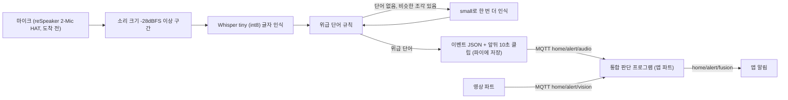

# AI_HUMAN_CARE — 독거노인 위험 감지·알림 시스템 (음성 파트 기록)

> **📌 11/16 현재 방식은 [`voice/README.md`](voice/README.md)를 먼저 보세요.**
> 11/16부터 감지 방식이 바뀌었습니다. 아래 본문은 11/08 기준 기록으로 그대로 남겨 둡니다.
>
> | 항목 | 11/08 (아래 본문) | 11/16 현재 |
> |---|---|---|
> | 감지 방식 | Whisper tiny + 위급 단어 규칙 | **직접 설계한 TC-ResNet 모델** (외부 음성 인식 사용 안 함) |
> | 하드웨어 | 마이크·파이5 도착 전 | Raspberry Pi 4 + reSpeaker, 쿨러 없음 |
> | 클립 | 파이에 저장만, 앱으로 보내지 않음 | 파이의 클립 서버(`:8080/clips/`) 주소를 JSON `clip_url`에 담음 |
> | 앱 연동 | MQTT 토픽 `home/alert/audio` → 통합 판단 프로그램 | MQTT 브리지 방식 (앱은 음성 파이 서버 하나에 접속) |
> | 결과 | — | 실제 녹음 47/73 감지, 오경보 0/3.6시간, Pi 판단 16~20ms, 1시간 최고 60.3℃ |

> 이 저장소는 **음성 파트의 진행 과정, 판단 기준, 실험 결과, 팀 공유 사항**을 시간순으로 기록한 곳입니다.
> 다른 팀원이 "무엇을, 왜, 어떤 근거로 결정했는지"를 처음부터 따라올 수 있게 쓰는 것이 목적입니다.
> 마지막 갱신: 2026-11-08 (작성 시점 기준, 이후 변경은 `docs/01_TIMELINE.md`에 이어서 기록)

## 한 줄 요약

위급 상황의 **음성**(도움 요청)을 라즈베리파이에서 감지해, 앱 파트의 통합 판단 프로그램으로 **MQTT 이벤트**를 보내고 앞뒤 약 10초 클립은 **파이에 저장**하는 것이 목표입니다 (클립은 앱으로 보내지 않기로 11/06에 합의).
**11/08 기준으로 위급 감지 방식을 바꿨습니다.** 소리 분류 모델(CNN, YAMNet)은 직접 녹음한 일상 소리에서 오경보가 시간당 수십~수백 회라서 단독 알림에 쓸 수 없었고, 대신 **말소리를 글자로 바꿔 위급 단어를 찾는 방식**(Whisper tiny + 규칙)이 파이4에서 구간당 2.7초로 돌아가며 "도와주세요" 34/34, 처음 보는 문장 31/39, 일상 소리 3시간+87분에서 오경보 0회를 얻었습니다 ([11](docs/11_VOICE_ASR_TRACK.md)).
마이크(reSpeaker)와 파이5는 아직 도착 전이라 **마이크 입력과 영상 동시 실행은 시험하지 못했습니다.**

## 시스템 구조 (11/08 기준)

## 현재 방식의 핵심 결과 (2026-11-08, 파이4, 음성 팀 녹음 기준)

| 항목 | 값 | 비고 |
|---|---|---|
| "도와주세요" 재현율 | 34/34 | 5초 간격 17번 × 기기 2대 |
| 처음 보는 문장 | 119 불러주세요 12/13, 사람 살려 9/13, 살려주세요 10/13 (합 79%) | 목소리를 바꿔 13번씩 |
| 오경보 | 0회 | 연속 일상 소리 3시간(학습에 쓰지 않은 기기) + 다른 녹음 87분 |
| 처리 시간 | 구간당 평균 2.7초, 3시간 중 6.1% | 파이4, 스레드 2 |
| 소리 분류 모델(비교) | 같은 3시간에서 재현율 85%일 때 오경보 시간당 92회 | 단독 알림 폐기 ([11 §4](docs/11_VOICE_ASR_TRACK.md)) |
| 서비스 운용 (파이4, 파일 입력) | MQTT 17/17 도착, 자동 시작·재시작 확인, 3시간 장시간 시험 감지 8/8·오경보 0·메모리 증가 없음, 이벤트 지연 중앙 3.1초 | [11 §7-1](docs/11_VOICE_ASR_TRACK.md) |
| 아직 못 한 것 | **실제 마이크, 파이5·영상 동시 실행, 어르신 목소리, TV 속 대사** | 마이크·파이5 도착 후 ([13](docs/13_MIC_DAY_RUNBOOK.md)) |

## 이전 갈래의 결과 (소리 분류 CNN, 2026-11-03 기준, 기록용)

| 항목 | 값 | 비고 |
|---|---|---|
| 학습 데이터 | AI Hub 위급상황 음성/음향(088) 중 5개 클래스 + 한국어 낭독 음성(Zeroth-Korean) | [03_DATA](docs/03_DATA.md) |
| 모델 | 로그멜(64×251) + 4블록 CNN, 6만 파라미터, 입력 2.5초 | [04_MODEL_EXPERIMENTS](docs/04_MODEL_EXPERIMENTS.md) |
| 위급 재현율 (정상 소음 오경보 1% 기준) | v1: 93.1% | 같은 출처 데이터 기준이라 낙관적 |
| 일반 말소리 오경보 (같은 기준) | v0 87.9% → v1 0.9% | 일상 말소리를 정상으로 넣은 효과 |
| 라즈베리파이4 처리 시간 | v2_no_part 23ms (실시간의 4.6%), v2_wide 55ms (약 11%) | 규칙·클립·JSON 서비스까지 확인 |
| 연속 환경 평가 (스트리밍) | 오경보 시간당 1~3회 이하일 때 감지율 v1 0.26 → v2 0.40~0.48 | 창 단위 93%는 과대평가였음 ([04 §8, §9](docs/04_MODEL_EXPERIMENTS.md)) |

- 이 갈래와 YAMNet 갈래([10](docs/10_YAMNET_TRACK.md))는 **직접 녹음한 일상 소리로 시험한 뒤 단독 알림용으로는 쓰지 않기로** 했습니다 ([02 D25](docs/02_DECISIONS.md)).

## 가장 중요한 한계 3가지

1. **"도와주세요" 외 문장은 약 70~90%이고, 어르신 목소리·다급하거나 흐릿한 발음·먼 거리·TV 속 대사는 시험하지 못했습니다.** 한 사람이 한 집에서 만든 녹음이라 일반화도 보장되지 않습니다.
2. **마이크(reSpeaker), 파이5, 영상과의 동시 실행은 아직 시험하지 못했습니다.** 방열판 없는 파이4에서는 온도 제한(최고 약 82℃)이 걸렸고, 파이5 속도는 추정입니다 ([11 §8](docs/11_VOICE_ASR_TRACK.md)).
3. **일상 표현과 겹치는 단어**("좀 도와주세요", "택시 불러주세요")는 글자만으로 구분되지 않습니다. 반복 규칙(30초 안에 2회 이상이면 긴급), 영상 결합, 음량 게이트로 보완할 계획입니다 ([12](docs/12_TEAM_AGREEMENT_V05.md)).

## 문서 지도 (이 순서로 읽으면 흐름이 이어집니다)

| 순서 | 문서 | 내용 |
|---|---|---|
| 1 | [docs/01_TIMELINE.md](docs/01_TIMELINE.md) | **시간순 진행 기록** (무엇을 했고, 왜, 결과, 다음) |
| 2 | [docs/02_DECISIONS.md](docs/02_DECISIONS.md) | **판단 기준과 의사결정 기록** (결정, 근거, 대안, 재검토 조건) |
| 3 | [docs/03_DATA.md](docs/03_DATA.md) | 데이터 출처, 라이선스, 구조, 통계, 전처리 규칙 |
| 4 | [docs/04_MODEL_EXPERIMENTS.md](docs/04_MODEL_EXPERIMENTS.md) | 모델, 학습, 실험 결과와 해석, 한계 |
| 5 | [docs/05_RASPBERRY_PI.md](docs/05_RASPBERRY_PI.md) | 파이 환경, 속도 측정, SSH 사용법, 마이크 설치 계획 |
| 6 | [docs/06_COLAB_RUNBOOK.md](docs/06_COLAB_RUNBOOK.md) | 코랩 재현 순서, GPU 한도 대응, 비용 정보 |
| 7 | [docs/07_ROADMAP.md](docs/07_ROADMAP.md) | 마이크 전/후 체크리스트와 일정 |
| 8 | [docs/08_TEAM_SHARING.md](docs/08_TEAM_SHARING.md) | **팀원과 공유·협의할 사항** (앱 연동 JSON 초안, 필요한 결정) |
| 9 | [docs/09_CORRECTIONS_AND_LESSONS.md](docs/09_CORRECTIONS_AND_LESSONS.md) | 틀렸다가 바로잡은 것과 배운 점 |
| 10 | [docs/10_YAMNET_TRACK.md](docs/10_YAMNET_TRACK.md) | **YAMNet 임베딩 갈래** (11/05 추가: 데이터 구조, 위상 반대 스테레오 문제, 분류기 결과, 녹음 계획) |
| 11 | [docs/11_VOICE_ASR_TRACK.md](docs/11_VOICE_ASR_TRACK.md) | **단어 인식 갈래** (11/08: 직접 녹음 평가, 소리 모델 한계, Whisper 설정 시험, 파이4 실측, 파이5 추정) |
| 12 | [docs/12_TEAM_AGREEMENT_V05.md](docs/12_TEAM_AGREEMENT_V05.md) | **팀 데이터 협약안 v0.5** (MQTT, 메시지 항목, 판단 규칙, 합의 기록) |
| 13 | [docs/13_MIC_DAY_RUNBOOK.md](docs/13_MIC_DAY_RUNBOOK.md) | **마이크 도착 당일 런북** (설치, 보정, 시험 순서와 합격 기준) |
| 14 | [docs/14_RECORDING_CONSENT_TEMPLATE.md](docs/14_RECORDING_CONSENT_TEMPLATE.md) | 녹음 동의서 양식(초안) |
| 15 | [docs/15_PI5_TEMP_SESSION.md](docs/15_PI5_TEMP_SESSION.md) | **파이5 임시 확인 세션 계획** (SD카드를 파이5에 잠깐 꽂아 속도·열 실측, 계획만 있고 아직 미실행) |
| - | [docs/EXPERIMENT_LOG.md](docs/EXPERIMENT_LOG.md) | 실험 기록표와 앞으로 쓸 양식 |
| - | [docs/GLOSSARY.md](docs/GLOSSARY.md) | 용어 설명 (AUC, 재현율, 멜 스펙트로그램 등) |
| - | [docs/CREDITS.md](docs/CREDITS.md) | 데이터·소프트웨어 출처와 사용 조건 |
| - | [code/README.md](code/README.md) | 코랩 셀과 스크립트 (재현용) |

## 저장소 규칙

- **데이터, 녹음 파일, 학습된 모델 파일, 인식한 글자 파일(`*_windows.jsonl`, 개인 대화 포함)은 올리지 않습니다.** AI Hub 데이터는 재배포가 제한됩니다. (`.gitignore` 참고)
- **개인 정보와 접속 정보를 올리지 않습니다.** IP 주소, 계정명, 비밀번호, 키, 와이파이 이름, 개인 폴더 경로는 `<PLACEHOLDER>`로 씁니다.
- 숫자는 **어떤 조건에서 얻은 값인지**(데이터, 기준값, 날짜)를 함께 적습니다.
- 확인하지 못한 내용은 `(추정)` 또는 `(확인 필요)`로 표시합니다.
