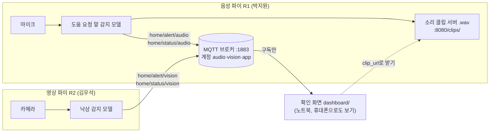
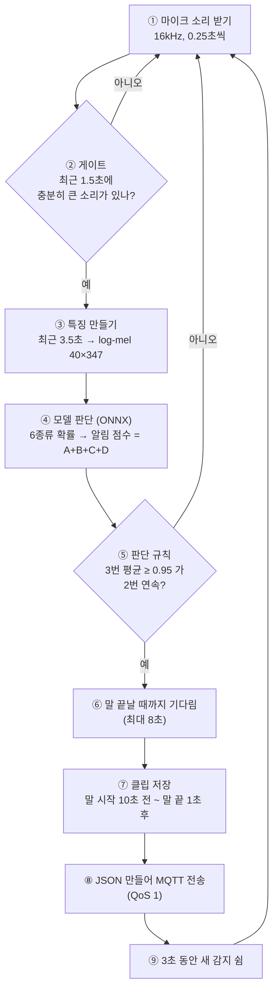

# 음성 위급 감지 — 독거노인 위험 감지 및 알림 시스템

> AI 휴먼케어 학생연구회 · 음성 파트(박지원) · 마지막 갱신 2026-11-18
> 라즈베리파이 4 + 마이크로 집 안 소리를 듣다가 **"도와주세요", "살려주세요", "사람 살려", "119 불러주세요"** 같은 도움 요청 말을 들으면, 그 순간의 소리를 파일로 저장하고 앱에 알림을 보낸다.
> 모델은 외부 음성 인식(Whisper 등)을 쓰지 않고 **직접 설계·학습한 작은 모델**이다.

---

## 목차

1. [한눈에 보기](#1-한눈에-보기)
2. [전체 시스템에서 음성 파트의 위치](#2-전체-시스템에서-음성-파트의-위치)
3. [음성 파트가 동작하는 순서](#3-음성-파트가-동작하는-순서)
4. [모델 설계와 그렇게 정한 이유](#4-모델-설계와-그렇게-정한-이유)
5. [데이터: 무엇으로 배우고 무엇으로 시험하나](#5-데이터-무엇으로-배우고-무엇으로-시험하나)
6. [개발 과정: 1차 → 2차 → 3차](#6-개발-과정-1차--2차--3차)
7. [라즈베리파이 실측 결과](#7-라즈베리파이-실측-결과)
8. [주요 결정 기록](#8-주요-결정-기록)
9. [한계와 다음 할 일](#9-한계와-다음-할-일)
10. [폴더 구조와 실행 방법](#10-폴더-구조와-실행-방법)
11. [용어 정리](#11-용어-정리)

---

## 1. 한눈에 보기

| 항목 | 내용 |
|---|---|
| 하는 일 | 도움 요청 말 감지 → 클립 저장 → JSON 알림을 MQTT로 전송 |
| 하드웨어 | Raspberry Pi 4, reSpeaker 2-Mics Pi HAT V2.0, 쿨러 없음 |
| 모델 | TC-ResNet(약 30만 매개변수), ONNX 파일 1.2MB, 직접 설계·학습 |
| 감지 대상 | 도와주세요 계열(A), 살려·구해주세요(B), 사람 살려(C), 119(D) |
| 현재 성능 (개발용 실제 녹음) | 응급 말 73개 중 **47개(64%)** 감지, 오경보 **0번 / 3.6시간** |
| 라즈베리파이 실측 | 판단 1번에 **16~20ms**, 1시간 연속 최고 **60.3℃**, 오경보 **약 21시간에 3번** |
| 알림 형식 | `{incident_id, confidence, occurred_at, clip_url}` |
| 현재 단계 | 모델·서비스·MQTT 서버 완성, 자동 실행, 시험 키트 배포 → 점검·최종 시험 (11/18 기준) |

---

## 2. 전체 시스템에서 음성 파트의 위치

음성 파이(R1)와 영상 파이(R2)가 각각 위험을 감지한다. **11/23부터** 통신은 김우석 MQTT 배포 문서 v1.1.0 기준이다: MQTT 브로커는 **음성 파이 하나**이고, 영상 파이와 확인 화면은 여기에 **직접 접속**한다(브리지 없음, [D38](../docs/02_DECISIONS.md)). 11/16~11/20에는 브리지 방식이었다(D36).



| 토픽 | 보내는 쪽 | 내용 |
|---|---|---|
| `home/alert/audio` | 음성 파이 (계정 audio) | 감지 JSON 4필드 |
| `home/alert/vision` | 영상 파이 (계정 vision) | 감지 JSON 4필드 |
| `home/status/audio`, `home/status/vision` | 각 파이 | `online` / `offline` (retain). 비정상 종료는 브로커가 LWT로 `offline` |

- 음성 알림 번호는 `A_`, 영상 알림 번호는 `V_`로 시작한다.
- 확인 화면은 `app` 계정으로 **구독만** 하고, 두 감지가 10초 안에 나면 타임라인에 선으로 이어 **보여 줄 뿐** 판단 등급은 만들지 않는다([D41](../docs/02_DECISIONS.md)).
- 현장(휴대폰 핫스팟)에서는 R1 주소가 바뀌므로 확인 화면이 R1을 **자동으로 찾는다**([D40](../docs/02_DECISIONS.md)).
- 음성과 영상은 **서로 다른 상황을 잡는다.** 카메라 밖에서 쓰러져 말하면 음성만, 쓰러져 말을 못 하면 영상만 잡는다. 그래서 두 팀의 정확도를 똑같이 맞추기보다 **두 신호를 함께 보는 것**이 중요하다.

### 앱으로 보내는 JSON

```json
{
  "incident_id": "A_261113231717",
  "confidence": 0.99,
  "occurred_at": "2026-11-13T23:17:17+09:00",
  "clip_url": "http://<음성파이주소>:8080/clips/A_261113231717.wav"
}
```

| 필드 | 뜻 |
|---|---|
| `incident_id` | `A_` + 소리가 난 시각(연월일시분초). 같은 초에 두 번 나면 `_2`, `_3`을 붙인다 |
| `confidence` | 알림 점수(0~1). 기준(0.95)을 넘을 때만 보내므로 보통 0.95~1.00이다. 영상 점수와 같은 잣대로 비교하면 안 된다 |
| `occurred_at` | **실제로 소리가 난 순간(말 시작 시각)**, 한국 시간(+09:00). 모델이 판정을 끝낸 시각이 아니다. 영상 알림과 10초 안에 함께 났는지 비교하는 기준이라 두 파이 시계를 NTP로 맞춘다 (파이 4는 켠 직후 몇 분 틀릴 수 있음) |
| `clip_url` | 말 시작 10초 전 ~ 말 끝 1초 후 소리 파일. **저장을 마친 뒤에** 알림을 보낸다 |

MQTT는 음성 파이 자체 서버(`localhost:1883`)의 토픽 `home/alert/audio`로, 계정 `audio`와 QoS 1(받았다는 확인을 받을 때까지 다시 보냄)을 쓴다. 보내기에 실패하면 파일에 쌓아 두었다가 연결되면 다시 보낸다. 접속하면 `home/status/audio`에 `online`, 정상 종료하면 `offline`을 보내고, 갑자기 꺼지면 브로커가 LWT로 `offline`을 대신 보낸다(11/23, [D39](../docs/02_DECISIONS.md)).

---

## 3. 음성 파트가 동작하는 순서



| 단계 | 하는 일 | 왜 필요한가 |
|---|---|---|
| ② 게이트 | 조용할 때는 모델을 아예 돌리지 않는다 | 조용한 방의 잡음에 반응하는 오경보를 막고, 계산량·발열을 줄인다 |
| ③ 특징 | 소리를 사람 귀처럼 주파수별 세기 그림(log-mel)으로 바꾼다 | 작은 모델이 배우기 쉬운 형태다 |
| ④ 모델 | 0.25초마다 최근 3.5초를 보고 6종류 중 무엇인지 확률을 낸다 | — |
| ⑤ 규칙 | 점수가 한 번 튀는 것만으로는 울리지 않는다 | 순간적인 오판을 거른다 |
| ⑦ 클립 | 앱 사용자가 실제 소리를 들어 볼 수 있게 한다 | 오경보인지 사람이 바로 확인할 수 있다 |

---

## 4. 모델 설계와 그렇게 정한 이유

### 입력과 특징

| 설정 | 값 | 이유 |
|---|---|---|
| 창 길이 | 3.5초 | 가장 긴 말("119에 신고해 주세요")이 2초 안팎이라 앞뒤 여유를 포함 |
| 판단 간격 | 0.25초 | 반응 속도와 계산량의 균형. 말 하나를 여러 번 보게 된다 |
| 특징 | log-mel 40개, n_fft 512, hop 160, 150~7600Hz | 말소리 대역만 남기고, 작은 모델에 맞는 크기 |
| 채널별 시간 평균 제거 | 적용 | 마이크마다 다른 음색(주파수 특성)을 지운다. 폰으로 녹음한 데이터와 Pi 마이크 차이를 줄이려는 목적 |
| RMS 정규화 | 적용 | 소리 크기 차이를 지운다. 크기 판단은 게이트가 따로 맡는다 |

### 분류 종류 (6개)

| 종류 | 예시 | 알림 |
|---|---|---|
| none | 일상 소리, 일상 말, TV, 조용함 | ✗ |
| A | 도와주세요, 도와줘요, 누가 좀 도와주세요 | ✓ |
| B | 살려주세요, 구해주세요 | ✓ |
| C | 사람 살려 | ✓ |
| D | 119 불러주세요, 119에 신고해 주세요 | ✓ |
| E | 신고해 주세요, 경찰 불러주세요 (신고 계열) | ✗ |

- **알림 점수 = A+B+C+D 확률의 합.** 계열끼리 헷갈려도(예: B를 C로) 위급한 말이면 알림이 간다.
- **E를 따로 둔 이유:** "신고해 주세요"는 "119에 신고해 주세요"와 비슷하지만 알림 대상이 아니다. 아예 따로 배우게 해야 둘을 구분한다.

### 모델 구조: TC-ResNet

- 시간 방향으로 1차원 합성곱을 쌓은 작은 ResNet 구조로, 키워드 감지(KWS)용으로 알려진 설계를 참고해 직접 구현·학습했다.
- 1차에서 TC-ResNet, BC-ResNet, CRNN, DS-CNN 4가지를 같은 조건으로 비교해 가장 나은 TC-ResNet을 골랐다(6장).
- 약 30만 매개변수, ONNX로 바꾸면 1.2MB. Pi 4에서 판단 1번에 16~20ms로, 쿨러 없이 계속 돌려도 된다.

### 판단 규칙

| 규칙 | 값 | 이유 |
|---|---|---|
| 평균 | 최근 3번 점수의 평균 | 한 번 튀는 점수를 누른다 |
| 연속 | 평균이 기준 이상인 상태가 2번 이어질 때 | 순간적인 오판을 거른다 |
| 쉼 | 감지 후 3초 | 한 번 말했는데 알림이 여러 번 가는 것을 막는다 |
| 기준 | **0.95** | 개발용 녹음에서 오경보 0을 지키는 가장 낮은 값(8장) |
| 게이트 | 최근 1.5초 안에 "바닥 소리 + 15dB" 이상이고 -65dBFS 이상인 20ms 구간이 있을 때만 판단 | 방마다 바닥 소리가 달라서 고정값 대신 바닥 기준으로 정함(8장) |

---

## 5. 데이터: 무엇으로 배우고 무엇으로 시험하나

**원칙: 학습용과 시험용 녹음은 절대 섞지 않는다.** 섞으면 모델이 시험 문제를 미리 본 셈이라 성능이 부풀려진다.


### 학습 데이터를 만드는 방법

- AI Hub 말 조각을 배경 소리·일상 말과 섞어 3.5초 창을 만든다(합성 창). 말의 위치·빠르기·크기는 매번 다르게 뽑는다.
- **마이크 흉내 증강:** 합성 창을 실제 방에서 마이크로 들은 소리처럼 변형한다. AI Hub 녹음은 깨끗하지만 실제 방과 마이크는 그렇지 않기 때문이다.
- 3차부터는 A~D 양성을 뽑을 때 **20%를 Pi 마이크로 직접 녹음한 R**에서 가져온다.

### Pi 마이크 녹음 코드 (`recording/rec_session.py`)

| 코드 | 용도 | 내용 |
|---|---|---|
| C0~C2 | 보정 | 조용한 방 1분, 1m·3m 위급 말 — 기준·게이트 조정에만 사용 |
| R1~R4 | **학습** | 1m 평소·약하게, 3m, 옆방(문 열림). 살려 5·사람 살려 4·119 5·도와주세요 2 비율 |
| P1~P8 | 시험(양성) | 1m, 3m, 옆방 문 열림/닫힘, 약한 목소리, 외침, 누운 자세, TV 켜고 |
| N1~N7 | 시험(오답) | 낮 3시간, 밤 8시간, TV 사건사고 20분, 비슷한 말, 신고 계열, 어려운 말, 생활 소리 |
| `--spk S2` | 시험 | 모델이 한 번도 못 들은 사람 목소리 — 학습에 넣지 않는다 |

R(학습용)의 계열 비율을 B·C·D 위주로 정한 이유: 2차 모델이 "도와주세요"는 80% 잡았지만 살려·사람 살려·119는 20~30%밖에 못 잡았기 때문이다.

---

## 6. 개발 과정: 1차 → 2차 → 3차


### 결과 (같은 개발용 실제 녹음: 응급 말 73개, 일상 3.6시간)

| 모델 | 기준 | 재현 | A 도와주세요 | B 살려 | C 사람 살려 | D 119 | 오경보 |
|---|---|---|---|---|---|---|---|
| s1_dscnn | 0.90 | 3/73 (4%) | 0.00 | 0.13 | 0.07 | 0.00 | 3번 |
| s1_crnn | 0.90 | 20/73 (27%) | 0.47 | 0.20 | 0.14 | 0.07 | 1번 |
| s1_bcresnet | 0.90 | 27/73 (37%) | 0.63 | 0.20 | 0.14 | 0.21 | 3번 |
| s1_tcresnet | 0.90 | 31/73 (42%) | 0.63 | 0.27 | 0.21 | 0.36 | 2번 |
| r2_tcresnet | 0.30 | 35/73 (48%) | 0.80 | 0.27 | 0.21 | 0.29 | **0번** |
| **r3_tcresnet** | **0.95** | **47/73 (64%)** | 0.73 | 0.60 | 0.50 | 0.64 | **0번** |
| (참고) Whisper | — | 65/73 (89%) | — | — | — | — | 0번 |

### 각 단계에서 배운 것

- **1차:** 구조를 바꾸는 것보다 데이터가 실제 환경과 다른 게 더 큰 문제였다. AI Hub는 외치는 연기가 많아서, 차분하게 말하는 실제 녹음에 약했다.
- **2차:** 실제 녹음을 섞자 좋아졌지만, 점수가 낮은 영역(기준 0.30)에서 겨우 버티는 상태라 마이크가 바뀌면 흔들릴 수 있었다. **학습을 3000단계에서 9000단계로 늘리면 실제 녹음에서 오히려 나빠졌다**(AI Hub 스타일에 과하게 맞춰짐). 그래서 3000단계를 유지했다.
- **3차:** Pi 마이크로 약한 계열(B·C·D)을 직접 녹음해 넣자 B·C·D가 두 배 이상 올랐고, 점수도 0.9 이상으로 뚜렷해졌다. 다만 R 녹음과 개발용 응급 녹음이 **같은 사람 목소리**라, 이 향상이 다른 사람에게도 그대로 나오는지는 아직 확인하지 못했다.

### 3차 모델의 기준별 결과 (기준을 고른 근거)

| 기준 | 재현 | 오경보 (3.6시간) |
|---|---|---|
| 0.50 | 65/73 | 51번 |
| 0.70 | 58/73 | 19번 |
| 0.90 | 52/73 | 3번 |
| 0.93 | 49/73 | 1번 |
| **0.95** | **47/73** | **0번** |
| 0.97 | 37/73 | 0번 |

기준을 낮추면 더 잡지만 오경보가 빠르게 늘어난다. 오경보 0을 지키는 가장 낮은 값인 0.95를 골랐다.

---

## 7. 라즈베리파이 실측 결과

모두 Raspberry Pi 4 + reSpeaker, 쿨러 없이 측정했다.

### 속도·온도

| 항목 | 결과 | 기준 |
|---|---|---|
| 판단 1번 | 파일 16ms, 마이크 실시간 20ms (0.25초 간격의 약 8%) | — |
| 1시간 연속 온도 | 49~60.3℃, 계속 오르지 않고 안정 | 80℃ 미만 ✓ |
| throttled | 0x80000 (이번 실행 전에 생긴 기록) → 11/18 재부팅 후 자동 실행에서 0x0 확인 | 0x0 |
| (참고) 예전 Whisper 3시간 | 83.7℃, 속도 제한 걸림 | — |

### 감지·오경보

| 시험 | 결과 |
|---|---|
| 보정 C1 (1m, 위급 말 16개) | 11/16 감지, 말 아닌 곳에서 울림 0번 |
| 조용한 방 C0 | 울림 0번 |
| 실시간 1시간 (위급 말 3번 + 노래 45분) | 3/3 감지, 노래 중 오경보 0번 |
| 일상 3시간 N1 | 오경보 2번 (뉴스 소리+키보드 1번, 혼잣말 1번) |
| TV 사건사고 뉴스 20분 N3 | 오경보 1번 (뉴스 속 이야기) |
| 혼잣말·키보드 1시간 TN1 | 오경보 0번 |
| 밤 + 빈집 오전 15.7시간 N2 | 오경보 0번 (밤에는 게이트가 거의 닫혀 모델이 거의 돌지 않음: 열림 0~5%) |
| **합계 약 21시간** | **오경보 3번 = 시간당 약 0.14번** (목표 1번 이하). 남은 약점은 TV·뉴스 말소리 |

### Pi 마이크에서 말소리 크기 (게이트 결정 근거)

| 녹음 | 말소리 최대 크기 중앙값 | 예전 게이트 -43dBFS 통과 비율 |
|---|---|---|
| C1·P1 (1m) | -38 ~ -41 dBFS | 65~94% |
| R1 (1m) | -46 dBFS | 17% |
| R2 (3m) | -43 dBFS | 47% |
| R4 (옆방) | -57 dBFS | 0% |

---

## 8. 주요 결정 기록

| 날짜 | 결정 | 이유 |
|---|---|---|
| 11/11 | 외부 모델을 가져오지 않고 직접 설계 | 프로젝트·하드웨어 조건에 맞춘 설계를 직접 공부·개발하는 것이 목적 |
| 11/13 | Pi 5 대신 Pi 4로 정식 운용 | Pi 5 고장, 교체품 없음 |
| 11/16 | 학습용(R)과 시험용(P·N) 분리, 다른 사람 목소리(S2)는 시험에만 | 성능이 부풀려지지 않게 하고, 처음 듣는 목소리로 시험할 조건을 남기기 위해 |
| 11/16 | 서비스 게이트를 -43dBFS 고정값에서 "바닥+15dB, -65dBFS 이상"으로 변경 | 같은 1m에서도 말 크기가 날마다 5~8dB 달라 고정값이 평소 목소리를 막았다(7장 표) |
| 11/16 | 기준 0.95 | 개발용 녹음에서 오경보 0을 지키는 가장 낮은 값 |
| 11/16 | Whisper는 최종 시스템에서 제외, 비교 숫자로만 사용 | 연구회 취지상 직접 만든 모델을 우선. 2단계(우리 모델 후보 → Whisper 확인)도 쓰지 않음 |
| 11/16 | 앱 연동은 MQTT 브리지 방식 | 앱이 한 서버만 관리하고 긴급 판단도 한 곳에서 하기 위해(앱 팀 제안 수용) |
| 11/16 | 미세한 정확도 향상보다 안정화·온도·최적화 우선 | 시스템 전체 품질은 영상·앱과 함께 결정되므로, 음성만 99%로 올리는 것보다 안정적으로 함께 동작하는 것이 중요 |
| 11/17 | `occurred_at`·`incident_id`를 **말 시작 시각**으로 | 앱이 영상 알림과 10초 안에 겹치는지로 긴급을 판단하므로, 판정을 끝낸 시각(1~3초 늦음)이 아니라 실제로 소리가 난 순간이어야 함(앱 팀 요청) |
| 11/17 | 음성 파이에 MQTT 서버(계정 5개·권한) 설정 | 브리지 방식에서 음성 파이가 중앙 서버. 계정마다 보내기·받기 토픽을 나눠 잘못된 전송을 막음(앱 팀 안내) |
| 11/18 | 학습용 오답 녹음(TN) 추가 | 실제 오경보가 난 소리(혼잣말·키보드, TV 뉴스)를 모델이 "알림 아님"으로 배우게 함. 시험용 N과는 섞지 않음 |
| 11/18 | 기준 0.95 유지 | Pi 약 21시간 오경보 3번(시간당 0.14번)으로 목표를 넉넉히 만족 |
| 11/18 | 와이파이 절전 끄기, 공유기에서 IP 고정 | 15시간 녹음 중 파이가 와이파이에서 떨어짐(절전 켜짐 확인). 현장에서 같은 일이 생기면 알림 전체가 끊김 |
| 11/18 | 서비스 자동 실행(systemd) | 전원만 켜면 시작, 멈추면 5초 뒤 재시작. 사람이 명령을 칠 수 없는 현장 점검용 |
| 11/18 | 1차 점검(11/20)은 시험 키트 zip을 현장 파이에 설치 | 마이크 없이 녹음해 둔 위급 말을 흘려 실제와 같은 알림·클립을 보냄. 내 파이·마이크를 가져가지 않아도 MQTT·브리지·앱 호환을 시험할 수 있음 |

---

## 9. 한계와 다음 할 일

### 알고 있는 한계

- **같은 화자 기준:** 학습용 Pi 녹음과 개발용 응급 녹음이 모두 같은 사람 목소리다. 다른 사람 목소리(S2) 시험이 필요하다.
- **TV 뉴스·혼잣말:** 길게 이어지는 말소리에서 점수가 기준 바로 위(0.96)로 올라가 오경보가 난 적이 있다.
- **옆방 문 닫힘:** 소리가 바닥 소리 근처까지 작아져 잡기 어렵다.
- **브로커가 음성 파이 하나:** 음성 파이가 꺼지면 영상 알림도 확인 화면에 가지 않는다(D38에서 받아들인 위험).
- **켠 직후 시계:** 파이 4는 시계 배터리가 없어 켠 직후 몇 분은 시각이 틀릴 수 있다. 시간 동기화를 확인한 뒤 시연한다.
- **와이파이:** 파이 4는 와이파이 절전이 켜져 있으면 오래 켜 둘 때 연결을 놓칠 수 있다(11/18 실제로 발생, 절전을 꺼서 대응).

### 다음 할 일

- [x] 재부팅 후 throttled 0x0 확인 (11/18), 1시간 연속 기록은 `data/stats.csv`
- [x] 서비스 자동 실행 등록(꺼지면 다시 켜짐) (11/18)
- [x] 음성 파이 MQTT 서버(계정 5개·권한) 설정, 실제 감지 → `home/alert/audio` 전송 확인 (11/17)
- [x] 파이 시간 맞추기(NTP 동기화, Asia/Seoul) 확인 (11/17)
- [x] 시험 키트(zip)로 다른 파이에서 설치·시험 가능 (11/18)
- [x] 밤 녹음(N2 15.7시간), 짧은 시험 녹음 1m 자리(P1, P5a, N4~N7) (11/18)
- [x] 1차 점검(11/20) — 음성 쪽 모두 통과
- [x] 통신 기준 v1.1.0 적용: 브로커 계정 3개·ACL, 상태 토픽·LWT, 권한·상태 시험 통과 (11/23)
- [x] 확인 화면(`dashboard/`), 집 Wi-Fi·휴대폰 핫스팟 리허설 통과 (11/23)
- [ ] 최종 시연(11/25, 음성·영상 통합): 연결 시험, 시나리오, 다른 사람 목소리(동의)
- [ ] (시연 결과를 보고 개인적으로) 학습용 오답 TV 녹음(TN2) → 4차 학습 → r3와 비교, 남은 시험 녹음
- [ ] 최종 문서·보고서 (12월 중순)

---

## 10. 폴더 구조와 실행 방법

```
voice/
├── README.md                     이 문서
├── .gitignore                    녹음·클립·실제 설정 제외
├── pi/                           라즈베리파이에서 돌리는 것
│   ├── kws_service.py            감지 서비스 (게이트·모델·클립 서버·MQTT)
│   ├── kws_service.example.json  설정 예시 (실제 kws_service.json은 올리지 않음)
│   └── model/
│       ├── r3_tcresnet.onnx           3차 모델
│       ├── r3_tcresnet_config.json    특징 설정·종류·기준
│       └── mel_fb.npy                 log-mel 계산용 필터
├── kit/                          다른 라즈베리파이에서 바로 시험하는 키트 (zip으로 배포)
│   ├── README.md                 키트 안내서 (설치 → 시험 → 문제 해결)
│   ├── install.sh                mosquitto·계정 5개·권한·파이썬 환경 설치
│   ├── run_test.sh / run_mic.sh  마이크 없이 시험 / 마이크로 실제 감지
│   ├── make_samples.py           내 녹음에서 감지되는 위급 말만 골라 샘플 만들기
│   ├── build_kit.sh              음성 파이에서 voice_test_kit.zip 만들기
│   └── mqtt/                     MQTT 서버 설정 (acl, conf)
├── recording/
│   └── rec_session.py            Pi 마이크 녹음 도우미 (정답표 labels.csv 자동 작성)
└── training/
    ├── help_kws_train_v3.ipynb   3차 학습 노트북 (Colab, T4)
    └── convert_help.py           AI Hub 데이터 변환 (PC)
```

녹음 파일, 클립, 실제 설정(비밀번호)은 저장소에 올리지 않는다.

### 감지 서비스 (Pi)

```bash
source ~/asr/bin/activate
cp kws_service.example.json kws_service.json      # 처음 한 번. MQTT 정보 채우기

python3 kws_service.py                             # 마이크로 실행
python3 kws_service.py --file 녹음.wav --no-mqtt   # 파일로 시험 (MQTT 안 보냄)
```

- 클립: `http://<파이IP>:8080/clips/<incident_id>.wav`
- 기록: `data/events.csv`(감지 내역), `data/stats.csv`(1분마다 판단 시간·게이트·온도·throttled)
- 마이크는 한 프로그램만 쓸 수 있다. 녹음 도우미나 예전 서비스가 돌고 있으면 먼저 끈다.

**자동 실행 (전원만 켜면 시작)**

```bash
sudo cp kws.service /etc/systemd/system/ && sudo systemctl daemon-reload
sudo systemctl enable --now kws        # 켜기 (부팅 때마다 자동)
sudo systemctl stop kws                # 녹음할 때 잠시 끄기 → 끝나면 start
journalctl -u kws -f                   # 실시간 기록 보기
```

| 설정 (`kws_service.json`) | 기본값 | 뜻 |
|---|---|---|
| `thr` | 0.95 | 알림 기준 |
| `gate_rel_db`, `gate_abs_dbfs` | 15, -65 | 게이트 |
| `pre_s`, `post_s` | 10, 1 | 클립 앞뒤 길이(초) |
| `http_port` | 8080 | 클립 서버 포트 |
| `mqtt` | 빈칸 | host, port, topic, username, password, tls, client_id |
| `mqtt.status_topic` | `home/status/audio` | 상태 토픽 (online/offline, LWT). 비우면 상태를 보내지 않음 |

### 확인 화면 (노트북)

음성·영상 감지를 보는 웹 화면은 [`dashboard/`](../dashboard/README.md)에 있다. 노트북에서 `run_live.bat`을 실행하면 같은 네트워크의 R1을 찾아 접속한다.

### 마이크 없이 시험 (Pi)

```bash
python3 kws_service.py --replay 샘플폴더/        # 엔터마다 녹음해 둔 위급 말을 실시간으로 흘려 보냄
bash ~/AI_HUMAN_CARE/voice/kit/build_kit.sh      # 다른 파이용 시험 키트 zip 만들기 (kit/README.md 참고)
```

### 녹음 (Pi)

```bash
python3 rec_session.py status          # 진행 현황
python3 rec_session.py go R            # 학습용만 순서대로
python3 rec_session.py go 1m           # 1m 자리 녹음 순서대로
python3 rec_session.py long N2_night   # 긴 녹음
python3 rec_session.py pack            # 드라이브에 올릴 묶음 만들기
```

### 학습 (Colab)

1. `pack` 묶음을 드라이브 `LAB/own_pi/`에 올린다(압축 풀지 않음).
2. `help_kws_train_v3.ipynb`를 Colab에서 열고 런타임을 T4로 설정한 뒤 '모두 실행'을 누른다(약 20분).
3. 끝나면 `LAB/kws/runs_full/r3_tcresnet/`의 `.onnx`, `_config.json`, `mel_fb.npy`를 Pi의 `pi/model/`로 옮긴다.
4. Colab은 '런타임 연결 해제 및 삭제'로 끝낸다.

---

## 11. 용어 정리

| 용어 | 뜻 |
|---|---|
| 재현(재현율) | 실제 위급 말 중 몇 개를 잡았나. 47/73이면 73번 말해서 47번 알림 |
| 오경보 | 위급 말이 아닌데 알림이 간 것. "시간당 몇 번"으로 센다 |
| 기준(threshold) | 알림 점수가 이 값을 넘어야 알림. 높이면 오경보↓ 재현↓ |
| 게이트 | 소리가 충분히 클 때만 모델을 돌리는 문지기 |
| dBFS | 디지털 소리 크기. 0이 최대이고 -65는 매우 작은 소리 |
| log-mel | 소리를 사람 귀처럼 주파수별 세기로 나타낸 그림 |
| ONNX | 학습한 모델을 다른 기기(Pi)에서 돌리기 위한 파일 형식 |
| MQTT | 작은 메시지를 주고받는 통신 방식. 서버(브로커)가 우체국처럼 전달한다 |
| QoS 1 | 받았다는 확인을 받을 때까지 다시 보내는 MQTT 전송 방식 |
| 브리지 | 한 MQTT 서버의 메시지를 다른 MQTT 서버로 자동으로 넘기는 연결 |
| throttled | Pi가 너무 뜨겁거나 전원이 약해 속도를 낮춘 적이 있는지 표시. 0x0이면 문제없음 |
| 증강 | 학습 데이터를 일부러 변형(울림·잡음·크기)해 다양한 환경에 강하게 만드는 것 |
