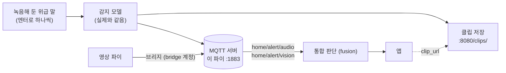

# 음성 파이 시험 키트 (voice_test_kit)

> 독거노인 위험 감지 시스템 · 음성 파트(박지원) · 11/20 1차 점검용
> **아무 라즈베리파이에나 설치하면 그 파이가 "음성 파이"가 됩니다.** 마이크가 없어도, 녹음해 둔 위급 말을 흘려서 실제와 똑같은 `A_` 알림과 소리 클립을 보냅니다.

---

## 이 키트가 하는 일



- 이 파이에 **MQTT 서버(mosquitto)**를 계정 5개와 권한까지 설정합니다(슬랙 11/17 앱 팀 안내와 같음).
- **마이크 대신 녹음 샘플**을 실시간으로 흘립니다. 모델, 판단 규칙, 클립 저장, MQTT 전송은 실제 서비스와 같은 코드입니다.
- 마이크(reSpeaker)가 달린 파이에서는 `run_mic.sh`로 실제 감지도 됩니다.

## 준비물

| 항목 | 조건 |
|---|---|
| 라즈베리파이 | **64비트** Raspberry Pi OS (`uname -m` → `aarch64`) |
| 인터넷 | 설치할 때만 필요 (핫스팟 가능) |
| 네트워크 | 앱 휴대폰, 영상 파이와 **같은 와이파이** |
| 주의 | **영상 파이에는 설치하지 마세요.** 영상 파이의 MQTT 설정(브리지)을 바꿉니다 |

---

## 1. 압축 풀기

zip 파일을 파이의 홈 폴더(`~`)에 옮긴 뒤:

```bash
cd ~
unzip voice_test_kit.zip
cd voice_test_kit
```

`unzip`이 없으면 `python3 -m zipfile -e voice_test_kit.zip .`

## 2. 설치 (처음 한 번, 2~5분)

```bash
bash install.sh
```

다섯 단계가 차례로 진행되고, 마지막에 아래처럼 나오면 성공입니다.

```
  ✓ MQTT 보내기·받기 성공
설치 끝. 이 파이 주소: 192.168.x.x  (앱·영상 브리지는 192.168.x.x:1883, 계정 비밀번호 모두 12345678)
```

**이 주소를 앱과 영상 파이 브리지 설정에 넣습니다.**

## 3. 시험 (마이크 없이)

```bash
bash run_test.sh
```

| 입력 | 동작 |
|---|---|
| 엔터 | 다음 위급 말 샘플을 흘려 보냄 |
| 번호 + 엔터 (예: `3`) | 그 번호의 샘플을 흘려 보냄 |
| `q` + 엔터 | 끝내기 |

자동으로 계속 보내려면 `bash run_test.sh --auto 60` (60초마다 하나씩).

엔터를 누르면 2~4초 뒤에 이렇게 나옵니다.

```
  ▶ 흘려 보냄: 01_A_도와주세요.wav
[감지] A_261120143012  말 5.1~6.3초  클립 7.3초  점수 0.99  (감지 후 1.8초 뒤 전송)
  {"incident_id": "A_261120143012", "confidence": 0.99, "occurred_at": "2026-11-20T14:30:12+09:00", "clip_url": "http://192.168.x.x:8080/clips/A_261120143012.wav"}
  MQTT: 전송
```

## 4. 받는 쪽에서 확인하는 방법

**같은 파이의 다른 터미널 창에서** (통합 판단 계정으로 모든 알림 보기):

```bash
mosquitto_sub -h localhost -u fusion -P 12345678 -t 'home/#' -v
```

- 앱: 이 파이 주소의 1883 포트, `app` 계정으로 접속
- 소리 클립: 휴대폰 브라우저에서 `clip_url` 주소를 열면 재생됩니다

---

## MQTT 정보

| 계정 | 비밀번호 | 할 수 있는 것 |
|---|---|---|
| `audio` | 12345678 | `home/alert/audio` 보내기 (이 키트가 사용) |
| `fusion` | 12345678 | `home/alert/vision`, `home/alert/audio`, `home/health/#` 받기 / `home/alert/fusion`, `home/status` 보내기 |
| `app` | 12345678 | `home/alert/fusion`, `home/status` 받기 |
| `bridge` | 12345678 | `home/alert/vision`, `home/health/vision` 보내기 (영상 파이 브리지) |
| `watchdog` | 12345678 | `home/health/#` 보내기 |

포트 1883, TLS 없음, 익명 접속 금지.

## 보내는 메시지

```json
{"incident_id": "A_261120143012", "confidence": 0.99, "occurred_at": "2026-11-20T14:30:12+09:00", "clip_url": "http://192.168.x.x:8080/clips/A_261120143012.wav"}
```

| 필드 | 뜻 |
|---|---|
| `incident_id` | `A_` + 소리가 난 시각. 같은 초에 두 번이면 `_2`, `_3` |
| `confidence` | 알림 점수. 기준 0.95를 넘을 때만 보내므로 0.95~1.00 |
| `occurred_at` | **실제로 말을 시작한 순간** (판정을 끝낸 시각이 아님) |
| `clip_url` | 말 시작 10초 전 ~ 말 끝 1초 후 소리. **저장을 마친 뒤** 메시지를 보냄 |

## 들어 있는 샘플

`samples/` 폴더의 위급 말은 박지원 본인 목소리를 실제 음성 파이 마이크로 녹음한 것이고, 모두 실제 모델로 감지되는 것만 골랐습니다. 계열은 A 도와주세요, B 살려·구해주세요, C 사람 살려, D 119입니다. `background.wav`는 조용한 방 소리로, 샘플 사이에 계속 흐릅니다.

## 폴더 구성

```
voice_test_kit/
├── README.md           이 안내서
├── install.sh          설치 (mosquitto, 계정·권한, 파이썬 환경)
├── run_test.sh         마이크 없이 시험
├── run_mic.sh          마이크로 실제 감지 (reSpeaker 필요)
├── kws_service.py      감지 서비스 (실제 서비스와 같은 코드)
├── kws_service.json    설정 (MQTT 계정·토픽, 클립 포트)
├── model/              감지 모델 (ONNX)
├── samples/            시험용 위급 말 + 배경 소리
└── mqtt/               MQTT 서버 설정 (계정 권한 acl 등)
```

실행 기록은 `data/events.csv`(감지 내역), 클립은 `data/www/clips/`에 쌓입니다.

---

## 문제 해결

| 증상 | 해결 |
|---|---|
| `64비트 Raspberry Pi OS가 필요해요` | 32비트 OS에서는 모델 실행 도구가 설치되지 않습니다. 64비트 OS 파이를 사용하세요 |
| 설치 3단계에서 오래 멈추거나 실패 | 인터넷 연결 확인 후 `bash install.sh` 다시 실행 (다시 해도 안전) |
| `mosquitto가 켜지지 않았어요` | 출력된 오류를 슬랙에 공유. 1883 포트를 다른 프로그램이 쓰는지 `sudo ss -ltnp | grep 1883` |
| `MQTT: 연결 안 됨` | `systemctl is-active mosquitto`가 `active`인지 확인. 보내지 못한 알림은 연결되면 자동으로 다시 보냄 |
| 엔터를 눌러도 `[감지]`가 안 나옴 | 2~4초 기다리기. 그래도 없으면 다른 번호 샘플로 시험 |
| 클립 주소가 휴대폰에서 안 열림 | 휴대폰과 파이가 같은 와이파이인지, 주소의 IP가 지금 파이 IP(`hostname -I`)와 같은지 확인 |
| `Address already in use` (8080) | `kws_service.json`의 `http_port`를 8081 등으로 바꿈 |
| 원래 MQTT 설정으로 되돌리기 | 설치 때 표시된 백업 폴더(`/etc/mosquitto/backup_날짜`)의 파일을 원래 자리로 복사 후 `sudo systemctl restart mosquitto` |

문의: 슬랙 #독거노인-낙상-감지-시스템 (박지원, 11/20은 저녁에 확인)
